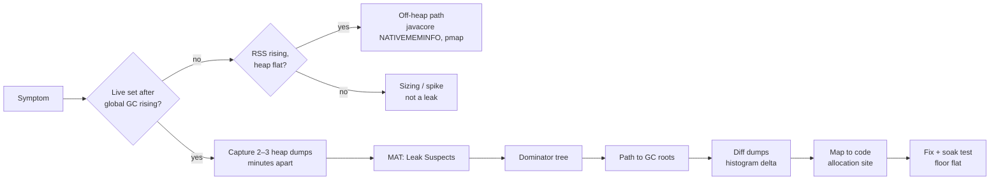

# Runbook 01 — From "memory keeps growing" to a named suspect

> Scope: IBM Semeru Runtime (Eclipse OpenJ9) 25 in containers, with the HotSpot equivalent given wherever the
> tooling differs. Every step can be reproduced against the LeakLab `sized` scenario.



---

## Phase 0 — Prove it is a leak before you dump anything

A heap dump is expensive (stop-the-world pause, disk, sensitive data). First establish that the shape of the
problem is a leak and not undersizing or a spike.

| Shape | Heap after **global** GC | GC frequency | Ends in |
|---|---|---|---|
| **Leak** | Rises monotonically, cycle after cycle ("sawtooth with a rising floor") | Increases as headroom shrinks | `OutOfMemoryError: Java heap space` — or OOMKill if mis-sized (see Runbook 02) |
| Undersized heap | Flat, but close to `-Xmx` | High, steady | OOM under peak load only |
| Allocation spike | Flat, then one vertical jump | Burst | OOM during one request; dump on `allocation` event (below) |
| Off-heap leak | **Flat** | Normal | RSS climbs, container OOMKilled; heap dump looks clean |

Where to read that signal:

- **LeakLab UI** – the green *Live set after GC* step line on the timeline and the *Live signal* panel (it computes the
  slope over the last 90 s and classifies heap vs. off-heap).
- **OpenJ9 verbose GC log** (`-Xverbosegclog:/dumps/verbosegc.%Y%m%d.%H%M%S.%pid.%seq.log,5,20000`, already set in the image) →
  open in **IBM GCMV** (Garbage Collection and Memory Visualizer) → plot *Used heap (after global collection)*.
  GCMV's report also prints a "heap occupancy trend" recommendation.
- **Prometheus** – `deriv(leaklab_heap_live_after_gc_bytes[10m]) > 0` for long windows; generically
  `jvm_memory_used_bytes{area="heap"}` sampled right after `jvm_gc_pause_seconds_count` increments.
- **javacore** – section `1STGCHTYPE GC History` lists the most recent collections with free/total bytes.

> **Cheap pre-check without a dump.** On a JDK image, run `jcmd 1 GC.class_histogram` (OpenJ9 supports it) twice,
> a few minutes apart, and diff. Classes whose instance count grows in proportion to traffic are your candidates.

---

## Phase 1 — Capture the evidence correctly

### 1.1 Which artefact answers which question

| Artefact | OpenJ9 | HotSpot | Contains | Answers |
|---|---|---|---|---|
| Heap dump | **PHD** `heapdump.*.phd` | HPROF `*.hprof` | Objects, classes, references. PHD has **no primitive values** (no String contents) and no field names | *What* is retained and *who* holds it |
| System dump | `core.*.dmp` (OS core) | `gcore` | Entire process image | Everything incl. field values and native memory — via DTFJ / `jdmpview` |
| Java dump | **javacore** `javacore.*.txt` | `jcmd Thread.print` (+ NMT) | Threads, locks, GC history, **NATIVEMEMINFO**, cgroup/ENVINFO | Native memory attribution, deadlocks, the JVM's view of the container |
| GC log | `-Xverbosegclog` (XML) | `-Xlog:gc*` | Every collection | The trend |
| Snap trace | `Snap.*.trc` | – | Trace buffer | IBM support |

### 1.2 How to trigger them (container-friendly first)

| Method | Command | Notes |
|---|---|---|
| Automatic on OOM | *(default on OpenJ9)* | Default agents write javacore + heapdump + snap (+ one system core) on `systhrow java/lang/OutOfMemoryError`. Log: `JVMDUMP055I Processing dump event "systhrow", detail "java/lang/OutOfMemoryError", exception "Java heap space"` (`JVMDUMP039I` on older releases), then `JVMDUMP010I Heap dump written to …`. HotSpot needs `-XX:+HeapDumpOnOutOfMemoryError -XX:HeapDumpPath=/dumps`. **Not covered:** an OOM thrown by Java code, such as "Cannot reserve … direct buffer memory", is a `throw` event, and no default agent (nor HotSpot's flag) reacts to it. Our image adds `-Xdump:java+heap:events=throw,filter=java/lang/OutOfMemoryError,msg_filter=*direct*,range=1..1`. |
| Signal | `kill -QUIT 1` | OpenJ9 → javacore. With `-Xdump:heap:events=user` (set in our image) → also a PHD. **Works in a JRE image without jcmd.** |
| jcmd (JDK image) | `jcmd 1 Dump.heap /dumps/h.phd` · `jcmd 1 Dump.java` · `jcmd 1 Dump.system` · `jcmd 1 GC.heap_dump /dumps/h.phd` | HotSpot: `jcmd 1 GC.heap_dump /dumps/h.hprof` (live objects only; `-all` to keep garbage) |
| API | `com.ibm.jvm.Dump.heapDumpToFile(path)` | What LeakLab's *Heap dump* button and `POST /api/dumps/heap` call. HotSpot: `HotSpotDiagnosticMXBean.dumpHeap` |
| Large-allocation trap | `-Xdump:heap:events=allocation,filter=#256m` | Dumps when a single allocation ≥ 256 MiB happens — catches *spikes*. `-Xdump:stack:events=allocation,filter=#8m` prints the allocating Java stack instead (cheap). |
| Pre-OOMKill | LeakLab **guardian** | Dumps at 90 % of the cgroup limit, because SIGKILL leaves no chance later (Runbook 02). |

### 1.3 The two-dump (three-dump) technique

One dump shows *what is big*. Two dumps show *what grows*, which is what a leak actually is.

1. Warm up the service (JIT, caches, pools filled). Capture **D1**.
2. Apply representative load for a fixed interval (LeakLab: *Slow leak* preset for 3–5 min). Capture **D2**.
3. Optionally **D3** after the same interval again — growth that is linear across D1→D2→D3 is decisive.

LeakLab exercise:

```bash
# sized scenario at http://localhost:8080
curl -XPOST localhost:8080/api/dumps/heap                       # D1 baseline
curl -XPUT localhost:8080/api/load -H 'Content-Type: application/json' \
     -d '{"running":true,"mode":"HEAP","ratePerSecond":20,"payloadKb":128,"retentionPercent":10}'
sleep 240
curl -XPOST localhost:8080/api/dumps/heap                       # D2
ls -lh dumps/semeru-25/sized
```

### 1.4 Hygiene that separates professionals from amateurs

- **Dumps contain data.** Session payloads, tokens, PII. Treat them as production data: encrypted volume, restricted
  access, retention policy, never attach to public tickets.
- **Disk**: a PHD omits primitive contents, so it can be *orders of magnitude* smaller than the heap — in LeakLab a
  600 MiB heap full of `byte[]` payloads produces a ~3 MiB PHD. An HPROF is ≈ the live heap; a system core ≈ RSS.
  Size the PVC for the worst case.
- **System cores in containers often fail**: they go through the host's `core_pattern`. Expect
  `JVMDUMP012E Error in System dump` in Docker Desktop and many clusters — the PHD and javacore are still written.
- **Pause**: dumps are stop-the-world. Liveness probes must tolerate it (`timeoutSeconds × failureThreshold` > dump time),
  otherwise the kubelet SIGKILLs the pod mid-dump — evidence destroyed *and* the death looks like an OOMKill (exit 137).
- **Never write dumps to tmpfs** (`emptyDir.medium: Memory`): the bytes are charged to the same cgroup.
- **Copy out** with `kubectl cp` / `oc rsync` (needs `tar`/`rsync` in the image), or `scripts/collect-evidence.sh`.

---

## Phase 2 — Open the dump

### Eclipse Memory Analyzer (MAT) — the primary tool

1. Install MAT (1.15+). Raise its own heap in `MemoryAnalyzer.ini` (`-Xmx` ≈ 1–1.5 × the dump's live heap).
2. **OpenJ9 only:** *Help → Install New Software…* and add the IBM DTFJ update site
   `https://public.dhe.ibm.com/ibmdl/export/pub/software/websphere/runtimes/tools/dtfj/`. Without DTFJ MAT cannot read
   `.phd` or `core.*.dmp`. HPROF needs nothing extra.
3. *File → Open Heap Dump* → choose **Leak Suspects Report** in the wizard.

Big dumps or no workstation? Parse headless on a beefy box and ship the HTML:

```bash
./ParseHeapDump.sh heapdump.sized.20261017.120000.1.phd \
  org.eclipse.mat.api:suspects org.eclipse.mat.api:overview org.eclipse.mat.api:top_components
# → *_Leak_Suspects.zip, *_System_Overview.zip, *_Top_Components.zip next to the dump
```

### Alternatives

- **IBM HeapAnalyzer** – reads PHD directly, quick tree of largest holders; good for a first look, less depth than MAT.
- **jdmpview** (ships with Semeru JDK) – for system cores: `jdmpview -core core.dmp`, then `info thread *`,
  `info class io.leaklab.leak.SessionContext`, `x/j <address>`, and `heapdump` (writes a PHD out of a core).
- **VisualVM** – HPROF only; good for a quick histogram and OQL on HotSpot.

---

## Phase 3 — Leak Suspects: the first hypothesis

MAT computes the dominator tree and reports objects or classes that accumulate a disproportionate share. For
LeakLab after ~5 min of *Aggressive leak* you should see something shaped like:

> **Problem Suspect 1**
> The class `io.leaklab.leak.CustomerSessionCache`, loaded by `io.quarkus.bootstrap.runner.RunnerClassLoader @ 0x…`,
> occupies **≈ 480 MB (93 %)**. The memory is accumulated in one instance of
> `java.util.concurrent.ConcurrentHashMap$Node[]`, loaded by `<system class loader>`.
> **Keywords:** `io.leaklab.leak.CustomerSessionCache` · `java.util.concurrent.ConcurrentHashMap$Node[]` · `byte[]`

Read it as three facts: **who** (a class → a static field), **where** (one map's backing array),
**what** (`SessionContext` → `byte[]`). It is a hypothesis; the next phases prove it.

---

## Phase 4 — Dominator tree: who keeps what alive

*Open the Dominator Tree* (toolbar) → *Group by class loader* or *Group by package* → sort by **Retained Heap**.

Two numbers matter:

- **Shallow heap** – the object itself (a `ConcurrentHashMap` is ~64 bytes).
- **Retained heap** – everything that would be freed if this object disappeared, i.e. everything it *dominates*
  (object X dominates Y if every path from a GC root to Y goes through X).

Expected chain:

```
class io.leaklab.leak.CustomerSessionCache                       retained ≈ 93 %
└─ java.util.concurrent.ConcurrentHashMap                         retained ≈ 93 %
   └─ java.util.concurrent.ConcurrentHashMap$Node[262144]
      ├─ ConcurrentHashMap$Node → io.leaklab.leak.SessionContext → byte[524288]
      ├─ ConcurrentHashMap$Node → io.leaklab.leak.SessionContext → byte[524288]
      └─ … ×N
```

A single, tiny-shallow, huge-retained object near the top is the textbook *accumulation point*.

---

## Phase 5 — Histogram: never stop at `byte[]`

*Histogram* sorts classes by shallow size, so `byte[]` / `char[]` / `String` almost always win. They are where the
bytes live, not why. The professional move:

1. Right-click `byte[]` → **Immediate Dominators**. The result groups the owners of those arrays:
   `io.leaklab.leak.SessionContext` owns ~all of them.
2. Right-click `SessionContext` → **Immediate Dominators** → `ConcurrentHashMap$Node[]` → `ConcurrentHashMap`.
3. *Calculate Precise Retained Size* on the histogram for the classes you care about.

Also useful from the histogram: *Group by package* — your own packages (`io.leaklab.*`) with growing instance counts
are far more telling than JDK classes.

---

## Phase 6 — Path to GC roots: the proof

Pick any `SessionContext` → right-click → **Path To GC Roots → exclude weak/soft/phantom/finalizer references**.

```
io.leaklab.leak.SessionContext @ 0x…
  ← val  java.util.concurrent.ConcurrentHashMap$Node
    ← [12345]  java.util.concurrent.ConcurrentHashMap$Node[]
      ← table  java.util.concurrent.ConcurrentHashMap
        ← SESSIONS  class io.leaklab.leak.CustomerSessionCache     ◀ GC root: System Class (static field)
```

Interpretation by GC-root type:

| Root type | Typical leak |
|---|---|
| **System class / static field** | Unbounded static caches, registries, singletons (this lab) |
| Thread (Java local / thread object) | `ThreadLocal` not removed on pooled threads; long-running tasks holding batches |
| JNI global | Native library holding Java objects |
| Busy monitor / finalizer | Finalizer backlog, objects pinned while synchronizing |
| Class loader | Redeploy/classloader leaks — use *Java Basics → Class Loader Explorer* (duplicate classes) |

> With **PHD**, references are present but field names and primitive values are not. If you need the *values* — e.g.
> to prove the keys are unique request ids rather than stable idempotency keys — take a **system dump** and open it
> in MAT via DTFJ or `jdmpview`, where `SessionContext.requestId` is readable.

Also run **Merge Shortest Paths to GC Roots** on the whole `SessionContext` class: if *all* instances funnel into
the same root, you have one leak, not many.

---

## Phase 7 — Diff the dumps: what grows

Open D1 and D2. In D2: *Histogram* → **Compare to another Heap Dump** (toolbar) → choose D1.

| Class | Δ objects | Δ shallow | Reading |
|---|---|---|---|
| `byte[]` | +N | +N × payload | where bytes go |
| `io.leaklab.leak.SessionContext` | **+N** | +N × ~40 B | **the leaking entity**: grows 1:1 with retained requests |
| `ConcurrentHashMap$Node` | +N | | the container of the leak |
| `java.lang.String` | +2N… | | ids inside each session |

A class whose delta is proportional to *elapsed requests* rather than to *concurrent requests* is leaking.
Cross-check with LeakLab: `kpi Retained by the leak` shows N `SessionContext` objects — the same N.

---

## Phase 8 — OQL for precise questions

MAT's *OQL* console (toolbar → OQL):

```sql
-- every accumulation point holding > 100 MB
SELECT m, m.@retainedHeapSize FROM java.util.concurrent.ConcurrentHashMap m
 WHERE m.@retainedHeapSize > 100000000

-- the leaking entities, largest first (sort the result by Retained Heap)
SELECT s, s.@retainedHeapSize FROM io.leaklab.leak.SessionContext s

-- direct buffers (off-heap memory referenced from the heap); capacity needs HPROF or a system core
SELECT b, b.capacity FROM java.nio.DirectByteBuffer b

-- classes loaded by more than one loader (classloader leak smell)
SELECT c.@displayName, c.@classLoader FROM java.lang.Class c WHERE c.@displayName LIKE ".*SessionContext.*"
```

Built-in queries worth knowing: *Java Collections → Collection Fill Ratio / Map Collision Ratio / Hash Entries*,
*Java Basics → Thread Overview* (ThreadLocals and per-thread retained size), *Top Consumers*, *Duplicate Strings*.

---

## Phase 9 — Map it back to code (and to the allocating call path)

A heap dump knows *who holds* an object, not *who allocated* it. Close the loop:

1. The dominating field is `CustomerSessionCache.SESSIONS` → find writers: `CustomerSessionCache.remember(..)` ←
   `CheckoutService.process(.., retryAware=true)` ← `LoadEngine.handleRequest` ← thread `leaklab-load-engine`.
2. For allocation call paths at runtime:
   - OpenJ9: `-Xdump:stack:events=allocation,filter=#256k..1m` prints the Java stack for allocations in that size range.
   - OpenJ9: IBM **Health Center** (where supported by your release) allocation and method profiling.
   - HotSpot: **JFR** `jdk.OldObjectSample` with `path-to-gc-roots=true` — the closest thing to an allocation-aware leak
     detector in production; or async-profiler in `alloc` mode.
3. State the root cause precisely:
   > *`CustomerSessionCache` is keyed by `requestId`, which is unique per request, so it never hits and never evicts.
   > Every request on the retry-aware path pins a `SessionContext` (+ its rendered quote) forever, via a static field.*

## Phase 10 — Fix and verify

- Fix: bounded, expiring cache keyed by a stable idempotency key — e.g. Caffeine
  `maximumSize(10_000).expireAfterWrite(Duration.ofMinutes(5))`; expose its size as a metric.
- Verify with a soak test: the live set after global GC must be **flat** under constant load (LeakLab *Healthy churn*
  shows what flat looks like: heavy allocation, zero growth).
- Guardrails: alert on `deriv(live-set-after-GC)`, on `working_set / limit > 0.85`, and keep the dump agents and PVC in
  place permanently — the next leak should be a 30-minute exercise, not an incident.

---

## Off-heap variant (LeakLab `native` scenario or *Direct* mode)

The heap dump is **clean**: `SessionContext` count ~0, a few hundred MiB of RSS unaccounted for. Switch tools:

1. **Gap analysis** – `RSS − heap committed` rising (LeakLab: *Process RSS* KPI and the pink/grey layers on the timeline).
2. **javacore `NATIVEMEMINFO`** – take two javacores (`kill -QUIT 1`) minutes apart and diff the `nMEMUSER` tree.
   Real output from the LeakLab `native` scenario, captured by the guardian seconds before the OOMKill:

   ```text
   2MEMUSER       +--Class Libraries: 634,832,712 bytes / 1283 allocations
   3MEMUSER       |  +--VM Class Libraries: 634,832,712 bytes / 1283 allocations
   4MEMUSER       |  |  +--sun.misc.Unsafe: 634,729,024 bytes / 1251 allocations
   5MEMUSER       |  |  |  +--Direct Byte Buffers: 1,116,368 bytes / 27 allocations
   5MEMUSER       |  |  |  +--Other: 633,612,656 bytes / 1224 allocations      ◀ FFM / Unsafe native leak
   ```

   *Direct Byte Buffers* growing → NIO direct buffers; *sun.misc.Unsafe → Other* → FFM `Arena` / `Unsafe` allocations;
   *Threads → Native Stack* → thread leak; *JIT* → compilation; *Classes* → class loading.
   Caveat: NATIVEMEMINFO counts **reservations** — *Java Heap* shows the full `-Xmx` reservation and *JIT Code Cache* its
   whole 192–256 MiB — so compare *deltas* between javacores, not absolute values against RSS.
3. **Direct buffers** are visible in the heap dump as tiny `java.nio.DirectByteBuffer` objects; their count is in any
   dump, their `capacity` only in an HPROF or a system core (a PHD has no primitive values). Capping `-XX:MaxDirectMemorySize` turns this leak into a diagnosable
   `OutOfMemoryError: Cannot reserve … bytes of direct buffer memory` (try *Direct* mode in the `sized` scenario). It
   only comes with dumps if an `events=throw` agent is configured (row "Automatic on OOM" above).
4. **Nothing in NATIVEMEMINFO grows but RSS does** → memory the JVM does not allocate itself (JNI libraries, glibc
   malloc arenas): `pmap -x 1 | sort -k3 -n | tail`, `/proc/1/smaps_rollup`, jemalloc profiling
   (`LD_PRELOAD` + `MALLOC_CONF=prof:true`). Many "Java native leaks" are glibc arena fragmentation — try
   `MALLOC_ARENA_MAX=2`.
5. HotSpot equivalent: `-XX:NativeMemoryTracking=summary` + `jcmd 1 VM.native_memory baseline` / `summary.diff`.
