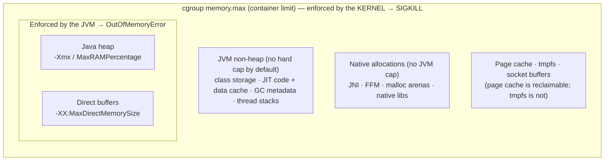

# Runbook 02 — When the kernel kills the JVM before Java ever runs out of memory

## Short answer

**Yes.** If the JVM is configured so that heap + everything else it needs can exceed the container's memory limit,
the Linux kernel's cgroup OOM killer sends **SIGKILL** to the process when the limit is reached. SIGKILL cannot be
caught, so:

- no `java.lang.OutOfMemoryError` is ever thrown,
- no `-Xdump` agent (OpenJ9) or `-XX:+HeapDumpOnOutOfMemoryError` (HotSpot) runs,
- no shutdown hook runs, buffered log lines are lost, and the log simply stops,
- the runtime records the death as **`OOMKilled`, exit code 137** (128 + signal 9).

The GC does not save you either: GC heuristics react to *heap* occupancy against *the JVM's own* limits. Neither
OpenJ9 nor HotSpot collects harder because the *container* is close to its limit. With `-Xmx` above the limit, the JVM
sees a half-empty heap and happily keeps expanding it — straight into the kill.

LeakLab's **`overcommit`** scenario reproduces exactly this, and its UI computes the risk live (the verdict banner).

---

## 1. Two enforcers, two budgets



The JVM only polices the inner box. The kernel polices the outer one. **The container dies before the JVM throws
whenever:**

```
  heap ceiling (-Xmx)  +  non-heap footprint  +  native  >  cgroup limit
```

LeakLab shows this formula live: *Heap ceiling + Native footprint + Direct allowance = Projected peak vs. Container
limit*, where the native footprint is measured as `RSS − heap committed` and the direct allowance is how far direct
buffers may still grow before their own cap (`MaxDirectMemorySize`, default ≈ max heap) stops them.

## 2. Ways to end up there

| # | Cause | Example | LeakLab |
|---|---|---|---|
| 1 | **Heap ceiling ≥ limit** (explicit overcommit) | `-Xmx1g` copied from a VM into a 512 Mi container | B · `overcommit` |
| 2 | **Heap ceiling + native > limit** — the most common in real life | `MaxRAMPercentage=95` on a 1 Gi limit: 973 Mi heap + ~80 Mi JVM non-heap | C · `greedy`, heap variant (OpenJ9; HotSpot fits by ~9 MiB) — see 2b |
| 3 | **Native / off-heap leak** — heap is irrelevant | JNI library, FFM/Unsafe, unclosed native resources | D · `native` |
| 4 | **Direct buffers without a cap** (implicit overcommit) | NIO/Netty, default cap ≈ max heap | C · `greedy`, its main experiment — see 2b |
| 5 | Thread explosion | each thread: stack + native structures | – |
| 6 | glibc malloc arena growth | many threads × 64 MiB arenas | – (`MALLOC_ARENA_MAX=2`) |
| 7 | Non-reclaimable memory in the same cgroup | `emptyDir: {medium: Memory}`, `/dev/shm`, writing dumps to tmpfs | – |
| 8 | Old JVM not container-aware | pre-8u191 HotSpot sizes heap from **host** RAM | – |

**Defaults matter.** In a container OpenJ9 sizes the heap from the cgroup limit: 50 % below 1 GiB, *limit − 512 MiB*
between 1 and 2 GiB, 75 % above 2 GiB. HotSpot defaults to 25 %. Setting `-XX:MaxRAMPercentage` makes the choice
explicit on both — and a hard-coded `-Xmx` silently ignores the limit.

## 2b. Overcommit with `MaxRAMPercentage` (no `-Xmx` anywhere)

"We use `MaxRAMPercentage`, so we're container-aware and safe" is a common belief. It is half true.
`MaxRAMPercentage` makes the **heap** follow the limit. It does not budget anything else. Unlike an explicit `-Xmx`
above the limit (Scenario B), this is an **implicit overcommit**: each number looks reasonable, only their sum doesn't
fit. The LeakLab **`greedy`** scenario (Scenario C, port 8082) runs the same image with only one memory flag, and its
leak target starts on **Direct**:

```yaml
mem_limit: 1g       memswap_limit: 1g
JAVA_OPTS: "-XX:MaxRAMPercentage=95"          # no -Xmx, no MaxDirectMemorySize
LEAKLAB_LOAD_MODE: DIRECT
```

**Before any load**, the control room's verdict is already red (real output from `/api/telemetry`):

```
OOMKILL_LIKELY — Heap ceiling + native footprint exceed the limit
Heap ceiling 972 MiB + non-heap footprint 71 MiB + direct-memory allowance 972 MiB (no MaxDirectMemorySize:
default ≈ max heap) = 1.97 GiB, above the 1.00 GiB limit.
```

That is Semeru. On HotSpot the heap and non-heap just fit, so the verdict names the direct allowance instead ("The
off-heap allowance doesn't fit in the room left"). **Experiment (b), the direct-buffer leak, is the scenario's main
experiment**: it ends in an OOMKill on all twelve variants (four JVMs, Java 17, 21 and 25). Experiment (a), the heap leak, is a knife edge that depends on
the JVM's non-heap size.

### Experiment (a): heap leak, 10 MiB/s

| t (s) | heap used | heap committed | RSS | working set | pressure |
|---:|---:|---:|---:|---:|---:|
| 0 | 64 MiB | 83 MiB | 174 MiB | 136 MiB | 13 % |
| 42 | 501 MiB | 646 MiB | 616 MiB | 576 MiB | 56 % |
| 76 | 830 MiB | 973 MiB | 952 MiB | 913 MiB | 89 % |
| 79 | 864 MiB | 973 MiB | 996 MiB | 957 MiB | 93 % ← guardian fires (91 %) |
| 85 | 926 MiB | 973 MiB | 1056 MiB | 1016 MiB | 99 % |
| 93 | — | — | — | — | connection lost |

```
docker inspect → OOMKilled=true ExitCode=137
guardian       → javacore in 113 ms, PHD in 248 ms, at 91 % of the limit
GC log, last   → <mem-info free="38143712" total="1020002304">   # 36 MiB of heap still free: no OutOfMemoryError
javacore       → 3CICGRPINFO Memory Limit : 1073741824 bytes    # the JVM KNEW the limit — and sized at 95 % of it
```

The heap committed to its full 973 MiB ceiling, and 92 % of that was live. The JVM saw free heap and had no reason to
throw. The kernel saw 1,016 MiB of 1,024 MiB used and killed the process. Note that **RSS (1,056 MiB) read above the
limit**: RSS also counts file-backed shared pages that are charged elsewhere. The kernel acts on the cgroup's
**working set**, which is why LeakLab plots both and why your alerts should use `container_memory_working_set_bytes`.

> **On HotSpot 25 (Red Hat, Oracle, Temurin) this experiment ends differently.** With the same flags HotSpot picks Serial GC
> and needs less non-heap memory, so it fits by about 9 MiB: a Java `OutOfMemoryError` with a heap dump, not an
> OOMKill. On **HotSpot 17 and 21** the non-heap footprint is 20–40 MiB larger and the container is OOMKilled again. The
> margin is too thin to rely on, and it moves with the Java version. See [Runbook 06](06-hotspot-jvms.md).

### Experiment (b): uncapped direct buffers, 10 MiB/s, heap flat

| t (s) | heap used | direct buffers | working set | pressure |
|---:|---:|---:|---:|---:|
| 0 | 59 MiB | 1 MiB | 124 MiB | 12 % |
| 45 | 60 MiB | 455 MiB | 584 MiB | 57 % |
| 82 | 59 MiB | 817 MiB | 956 MiB | 93 % ← guardian fires (91 %) |
| 88 | 58 MiB | 877 MiB | 1014 MiB | 99 % |
| 96 | — | — | — | connection lost → `OOMKilled=true`, exit 137 |

Without `-XX:MaxDirectMemorySize`, the direct-memory cap defaults to roughly the max heap (here ≈ 973 MiB). So
a direct-buffer `OutOfMemoryError` ("Cannot reserve … bytes of direct buffer memory") could only happen *after* heap and direct together had used ~1.9 GiB, in a
1 GiB container. The kernel acts at 877 MiB of direct memory. The guardian's javacore names the category exactly:

```
5MEMUSER       |  |  |  +--Direct Byte Buffers: 835,123,952 bytes / 1621 allocations
```

The heap dump holds only the small wrappers: MAT's `histogram java.nio.DirectByteBuffer` finds **1,664 objects using
119,808 bytes of heap**, standing for ~835 MB of native memory. MAT's Leak Suspects again points at the 24 MiB
parachute in a 6 %-full heap (see Runbook 04). The analysis-stage reports are in
[`analysis/examples/greedy-heap`](../analysis/examples/greedy-heap/SUMMARY.md) and
[`analysis/examples/greedy-direct`](../analysis/examples/greedy-direct/SUMMARY.md).

### Other ways `MaxRAMPercentage` still overcommits

| Way | Why the percentage doesn't help |
|---|---|
| Percentage too high for the size | Non-heap is roughly constant (~80–200 MiB). At 1 GiB, 95 % leaves 51 MiB for it |
| Native growth (FFM, JNI, threads, glibc arenas) | Not governed by any JVM flag (`native` scenario) |
| Direct buffers without a cap | Default cap ≈ max heap, on top of the heap (experiment b) |
| Wrong base for the percentage | No container detection (`-XX:-UseContainerSupport`, or a JVM too old for cgroup v2: HotSpot < 15 / 11.0.16 / 8u372), a limit set only on a parent cgroup, or no limit at all → percentage of **node** RAM |
| Limit changed after start | The heap ceiling is computed once at start-up; in-place resize does not shrink it |
| `-Xmx` injected elsewhere | `JAVA_TOOL_OPTIONS` from a base image or agent; `-Xmx` wins over the percentage |
| Several JVMs per container | Each takes its own percentage of the same limit: 2 × 60 % = 120 % |
| HotSpot, very small containers | Below ~250 MB the ceiling comes from `MinRAMPercentage` |

**Check what the JVM actually decided:** OpenJ9 `java -verbose:sizes -version` and javacore `3CICGRPINFO Memory
Limit`; HotSpot `java -XshowSettings:system -version` and `-XX:+PrintFlagsFinal`. **Fix:** choose the percentage
from a measured non-heap footprint (playbook: 50–60 % at ≤ 1 GiB), cap direct memory, and keep one JVM per container.

## 3. Failure signatures — tell them apart

| What happened | Docker | Kubernetes / OpenShift | JVM evidence |
|---|---|---|---|
| **Java heap OOM** | still running, or exit 1/3 if `-XX:+ExitOnOutOfMemoryError` | `Running` (or restart, reason `Error`) | `JVMDUMP055I … java/lang/OutOfMemoryError`, javacore + PHD in `/dumps` |
| **cgroup OOMKill** | `State.OOMKilled=true`, `ExitCode=137` | `lastState.terminated.reason: OOMKilled`, `exitCode: 137` | **none** — the log just stops |
| Liveness-probe kill | – | reason `Error`, exit 137, event `Liveness probe failed … will be restarted` | often GC thrashing in verbose GC (a dying leak looks like a hang) |
| Node-pressure eviction | – | pod `Failed`, reason `Evicted`, "The node was low on resource: memory" | none |
| Node-level (system) OOM | 137 | `OOMKilled`, node event `SystemOOM` | none |

Exit code 137 alone proves only *SIGKILL*. The **reason** field is what proves *memory*.

## 4. How to identify it after the fact

### Docker / Podman

```bash
docker inspect -f 'OOMKilled={{.State.OOMKilled}} Exit={{.State.ExitCode}} Finished={{.State.FinishedAt}}' leaklab-overcommit-semeru-25
# OOMKilled=true Exit=137 Finished=2026-10-17T10:42:13.51Z

docker events --filter event=oom --since 1h --until "$(date -u +%FT%TZ)"
docker logs --tail 20 leaklab-overcommit-semeru-25     # ends abruptly, no JVMDUMP lines
ls dumps/semeru-25/overcommit                          # only verbosegc logs — no javacore, no phd
```

`restart: "no"` in `compose.yaml` matters: with an auto-restart policy the evidence in `State` is overwritten.

### Kubernetes / OpenShift

```bash
oc get pod -l leaklab.io/scenario=overcommit \
  -o jsonpath='{range .items[*]}{.metadata.name}{"  "}{.status.containerStatuses[0].lastState.terminated.reason}{"  "}{.status.containerStatuses[0].lastState.terminated.exitCode}{"  restarts="}{.status.containerStatuses[0].restartCount}{"\n"}{end}'
# leaklab-overcommit-7c9d…  OOMKilled  137  restarts=3

oc describe pod <pod>         # Last State: Terminated  Reason: OOMKilled  Exit Code: 137
oc logs <pod> --previous      # the log of the killed instance — no JVMDUMP lines
oc get events --field-selector involvedObject.name=<pod> --sort-by=.lastTimestamp
```

`terminationMessagePolicy: FallbackToLogsOnError` (set in the Deployment) copies the last log lines into
`lastState.terminated.message`, so `oc describe pod` shows what the JVM was doing when it died.

### The node's kernel log (the ground truth)

```bash
oc debug node/<node> -- chroot /host journalctl -k --since -2h | grep -iE 'oom-kill|Killed process|Memory cgroup out of memory'
# … oom-kill:constraint=CONSTRAINT_MEMCG,…,task_memcg=/kubepods.slice/…/crio-<id>.scope,task=java,pid=…
# … Memory cgroup out of memory: Killed process 412 (java) total-vm:…kB, anon-rss:519812kB, file-rss:…, oom_score_adj:…
```

`CONSTRAINT_MEMCG` = the container's own limit (not node exhaustion). `anon-rss` at kill time ≈ the limit.
On cgroup v2 the kubelet also sets `memory.oom.group=1`, so every process in the container is killed together.

### Metrics (Prometheus / OpenShift monitoring)

```promql
# the kill itself
kube_pod_container_status_last_terminated_reason{reason="OOMKilled"} == 1
increase(container_oom_events_total{container="leaklab"}[15m]) > 0

# the approach — alert at 85–90 %, this is your pre-mortem window
container_memory_working_set_bytes{container="leaklab"}
  / on(namespace,pod,container) kube_pod_container_resource_limits{resource="memory"} > 0.9

# which layer is growing: container minus heap = native footprint
container_memory_working_set_bytes{container="leaklab"}
  - on(pod) sum by (pod) (jvm_memory_used_bytes{area="heap"})
```

`scripts/oomkill-forensics.sh docker|k8s` automates the checks above and prints a verdict per container/pod.

### Absence of evidence is evidence

| Expect after a Java OOM | Present after an OOMKill? |
|---|---|
| `JVMDUMP055I` (older: `039I`) / `JVMDUMP010I` lines in stdout | no |
| `javacore.*.txt`, `heapdump.*.phd`, `Snap.*.trc` in `/dumps` | no |
| Stack trace `java.lang.OutOfMemoryError` in app logs | no |
| Graceful shutdown log lines (Quarkus "stopped in …s") | no |
| Verbose GC log | **yes** — and its last entries show the heap still had room |

That last point is the decisive one: the **verbose GC log** survives on the volume. In the LeakLab `overcommit` run its
final record reads `<mem-info free="1978776" total="524091392">`: the heap was committed at **500 MiB of a 1 GiB
`-Xmx`** and the JVM was about to *expand* it. From the JVM's point of view there was another half-gigabyte of heap
available. The kernel disagreed.

## 5. How to identify it *before* it happens

1. **Do the arithmetic at deploy time** (or let the LeakLab verdict do it):
   `limit − Xmx` must cover the measured non-heap footprint (RSS − heap committed at steady state) **plus** margin
   for threads, JIT bursts, and direct buffers. On OpenJ9 a small Quarkus service needs ~100–200 MiB of non-heap.
2. **Ask the JVM what it decided** inside the container:
   - OpenJ9: `java -verbose:sizes -version`; the javacore `ENVINFO` section reports container detection and the cgroup
     limit it saw.
   - HotSpot: `java -XX:+PrintFlagsFinal -version | grep -E 'MaxHeapSize|MaxRAMPercentage'`,
     `java -XshowSettings:system -version`.
   - Kernel: `cat /sys/fs/cgroup/memory.max /sys/fs/cgroup/memory.current /sys/fs/cgroup/memory.events`.
3. **Policy as code**: reject manifests whose `JAVA_OPTS` contain `-Xmx` larger than `resources.limits.memory`
   (Kyverno/OPA Gatekeeper), or simply ban `-Xmx` in favour of `MaxRAMPercentage`.
4. **Watch the kernel's counters**: `memory.events` → `max` increments every time the kernel had to reclaim at the
   limit — the knock on the door before `oom_kill`. LeakLab surfaces them under *Kernel's view*.

## 6. Capturing evidence anyway

SIGKILL forbids reacting *at* the limit, so react *before* it:

- **Pre-emptive dump at a threshold** — LeakLab's `OomGuardian` polls the cgroup working set every second and writes
  a javacore + heap dump at 90 % (re-arms below 75 %). The `native` scenario shows it saving the evidence seconds
  before the pod dies. Production equivalents: a sidecar/agent doing the same via `kill -QUIT`, or an alert-driven
  runbook automation.
- **Continuous low-cost telemetry** on a persistent volume: verbose GC log (always on), periodic javacores for
  NATIVEMEMINFO trends.
- **Make the JVM the first to fail**: size heap and `MaxDirectMemorySize` so their limits trip *before* the cgroup's.
  A Java OOM is diagnosable; an OOMKill is not.
- **…and then let it die cleanly**: add `-XX:+ExitOnOutOfMemoryError` in production. The dump agents run first, then
  the process exits and the platform restarts it. A JVM that survives an OOM is in an undefined state. LeakLab shows
  this in practice: any `invokedynamic` call site (lambda, string concatenation) linked for the first time during the
  OOM fails with `BootstrapMethodError: OutOfMemoryError` *and stays failed for the life of the JVM*. LeakLab only
  survives OOM for teaching purposes, using a lab-only memory "parachute" and a startup warm-up.
- cgroup v2 `memory.high` (Kubernetes *MemoryQoS*, alpha) throttles before the hard limit, buying time for the above.

## 7. Sizing guidance (starting points, then measure)

| Container limit | `MaxRAMPercentage` | Notes |
|---|---|---|
| ≤ 1 GiB | 50–60 % | Non-heap is a large fraction of small containers |
| 1–4 GiB | 60–70 % | |
| ≥ 4 GiB | 70–80 % | Native footprint grows sub-linearly with heap |

- `requests.memory == limits.memory`: the pod never exceeds its reservation, ranks last for node-pressure eviction,
  and can only die at its own limit. (Full *Guaranteed* QoS also needs CPU requests == limits.)
- Cap direct memory explicitly (`-XX:MaxDirectMemorySize`), keep `-Xss` sane, bound thread pools.
- `MALLOC_ARENA_MAX=2` for glibc-based images with many threads.
- Exec the JVM as PID 1 (`exec java …`): signals reach it, and `kill -QUIT 1` works for javacores.
- Liveness probes must not fail during GC storms or dumps, or you trade an OOMKill for a probe-kill that looks the same.
- A common production setting, 80 % with G1 (`-XX:MaxRAMPercentage=80 -XX:+UseG1GC -XX:G1ReservePercent=10`), is
  scenario G in the lab (port x085). A heap leak ends in a Java OOM on all twelve variants, but with direct memory
  uncapped a direct-buffer leak was a Java OOM at the very edge on seven, an OOMKill on three and a hung JVM on two.
  Adding `-XX:MaxDirectMemorySize=64m` turned it into a Java OOM everywhere it was tried (Runbook 06).

## 8. Reproduce it in the lab

```bash
docker compose up --build -d overcommit
open http://localhost:8081          # verdict banner: OOMKILL_BY_DESIGN — -Xmx 1 GiB vs limit 512 MiB
# UI → Heap target → "Aggressive leak". Watch working set climb into the hatched kill zone while heap is only ~half used.
# The UI loses contact; its banner explains why.
scripts/oomkill-forensics.sh docker leaklab-overcommit-semeru-25
# VERDICT: kernel cgroup OOM kill …  No JVMDUMP/OOM lines in the log
```

Then repeat in `sized` (port 8080): same leak, ending in a Java `OutOfMemoryError` with a full set of dumps.
That contrast is the whole lesson.

And Scenario C, the percentage trap (section 2b), with its main experiment, the direct-buffer leak:

```bash
docker compose up -d greedy
open http://localhost:8082          # verdict banner: OOMKILL_LIKELY with only MaxRAMPercentage=95 set
curl -XPUT localhost:8082/api/load -H 'Content-Type: application/json' \
  -d '{"running":true,"mode":"DIRECT","ratePerSecond":20,"payloadKb":512,"retentionPercent":100}'
scripts/oomkill-forensics.sh docker leaklab-greedy-semeru-25
docker compose --profile analysis run --rm -e BASELINE=- analyzer /dumps/semeru-25/greedy
```

To test the sizing guidance in section 7 with your own numbers, use the manual scenario (port 8084 on Semeru 25; see
the [README](README.md#your-own-sizing-the-manual-scenario)): it is what a plain `docker compose up` starts. It takes the JVM and Java version from the env file, the limit
and `JAVA_OPTS` from the shell (or from a second env file, `manual.env`), and its verdict banner shows whether they fit
before any load.

```bash
LEAKLAB_MANUAL_MEM=1g LEAKLAB_MANUAL_JAVA_OPTS="-XX:MaxRAMPercentage=75 -XX:MaxDirectMemorySize=128m" \
  docker compose --env-file semeru-25.env up -d               # verdict: TIGHT, ~966 of 1024 MiB at full heap and direct
```
