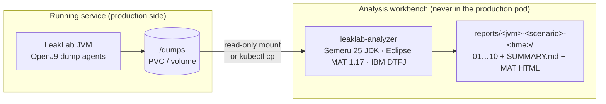

# Runbook 04 — The analysis stage: the tools, run for real

Runbooks 01–03 explain *what* to look for. This stage **does it**. A dedicated analyzer container runs the
full toolchain against the evidence LeakLab produced, and writes a numbered, explained report. Every output
quoted below is real. It was captured from the lab on IBM Semeru 25.0.4 (OpenJ9) and analysed with
Eclipse MAT 1.17.0 and IBM DTFJ. Full reports: [`sized`](../analysis/examples/sized/SUMMARY.md),
[`native`](../analysis/examples/native/SUMMARY.md), [`greedy-heap`](../analysis/examples/greedy-heap/SUMMARY.md) and
[`greedy-direct`](../analysis/examples/greedy-direct/SUMMARY.md).



## Why a separate stage?

| Concern | Consequence |
|---|---|
| Parsing a dump needs **~1–1.5× its live heap** in RAM and minutes of CPU | Doing it in the sick pod would trigger the next OOMKill. The analyzer has its own 4 GiB budget |
| Dumps contain **production data** | The workbench is the controlled place where they are opened. The evidence is mounted **read-only** |
| Tooling (MAT, DTFJ, JDK tools) doesn't belong in runtime images | The runtime image stays a slim JRE. The workbench is a separate, versioned image |
| Repeatability | The same image and scripts give the same report from the same evidence, ready to attach to an incident |

## Run it

```bash
docker compose --profile analysis build analyzer
docker compose --profile analysis run --rm analyzer                       # analyses ./dumps/redhat-21/sized (newest two dumps)
docker compose --profile analysis run --rm \
  -e TARGET=heapdump.sized.20261017.104316.1.phd \
  -e BASELINE=heapdump.sized.20261017.104116.1.phd analyzer /dumps/semeru-25/sized   # explicit pair
docker compose --profile analysis run --rm -e BASELINE=- analyzer /dumps/semeru-25/native   # single dump, no diff
```

The analyzer reads both JVMs' evidence: OpenJ9 PHDs, javacores and verbose GC logs; HotSpot `.hprof` / `.hprof.gz`,
VM reports (NMT) and unified GC logs (`gc.*.log`). Point it at any variant's folder, `/dumps/<jvm>-<version>/<scenario>` (`/dumps/oracle-21/native`, …),
exactly as at the Semeru 25 folders. Reports land in `analysis/reports/<jvm>-<version>-<scenario>-<UTC time>/`. Kubernetes/OpenShift: copy the evidence out first
(`scripts/collect-evidence.sh k8s …`), then point the analyzer at that folder.

### What's in the image

| Tool | Role |
|---|---|
| IBM Semeru Runtime 25 **JDK** | Runs MAT. Provides `jdmpview` (system cores), `jcmd`, and the OpenJ9 DTFJ modules |
| **Eclipse MAT 1.17.0**, headless (`ParseHeapDump.sh`) | Parses dumps, builds the dominator tree, runs reports and queries in batch mode |
| **IBM DTFJ** feature, installed with the p2 director | Lets MAT read OpenJ9 **PHD** and **core** files. Without it MAT reads only HPROF |
| `analyze.sh` | Orchestrates the ten steps and writes `SUMMARY.md` |
| `mat.sh` | Wraps MAT batch mode: `query`, `suspects`, `compare` |
| `gc-trend.sh` | Verbose GC XML → live set after each global GC, with a verdict (GUI equivalent: IBM GCMV) |
| `nativemem-diff.sh` | Diff of two javacores' NATIVEMEMINFO trees, with a verdict |

### The evidence used below

From the `sized` scenario: **D1** is the baseline heap dump after a release (heap ≈ 57 MiB). Then 120 s of
`HEAP · 40 req/s · 256 KiB · 20 % retained`. **D2** is the target heap dump. Ground truth reported by the app at
D2: **971** retained `SessionContext` objects, **254,541,824** bytes of payload.

---

## The ten steps

Each step answers one question. MAT batch commands are shown as `MAT> …`. The same command can be typed
into the GUI's command line (*Window → Command Line*, or the query browser).

### Step 1 — Inventory: what evidence do we have?

`01-inventory.txt` lists heap dumps, javacores and GC logs, newest first, and which two dumps are being compared.
**Why:** an analysis is only as good as its evidence. Check that you have two dumps **of the same JVM** (for
growth), javacores for native memory, and a GC log covering the period.

### Step 2 — GC trend: is the live set growing? (`gc-trend.sh`)

```
global GC end (UTC)       used after GC      heap size   pause ms
2026-10-17T10:03:26.846         30.6 MiB        46.8 MiB       29.9   ← aggressive leak starts
2026-10-17T10:03:44.865        277.2 MiB       397.5 MiB        8.9
2026-10-17T10:03:53.779        459.8 MiB       614.4 MiB       11.9   ← heap reaches -Xmx
2026-10-17T10:04:01.666        614.2 MiB       614.4 MiB       16.7   ← pinned: GC frees nothing
2026-10-17T10:04:24.186         37.7 MiB       614.4 MiB       13.1   ← "Release retained"
2026-10-17T10:41:16.236         56.9 MiB       457.8 MiB       37.4   ← D1 taken here
2026-10-17T10:43:16.895        303.3 MiB       456.5 MiB       78.8   ← D2 taken here
...
max heap (-Xmx): 614.4 MiB; live set peaked at 100% of it
VERDICT: heap exhausted — 22 global GCs recovered almost nothing (GC death spiral before OutOfMemoryError)
```

**How to read it:** only the column *used after GC* matters. Each global GC is a moment of truth: whatever is still
there is reachable. The table shows three stories in one log: a fast leak climbing to the ceiling, the **death
spiral** (22 global GCs freeing < 5 % each, the last phase before `OutOfMemoryError`), and after release the slow
leak that D1→D2 captures (57 → 303 MiB).
**GUI equivalent:** IBM GCMV, plot *Used heap (after global collection)*.

### Step 3 — Leak Suspects: MAT's first hypothesis (`MAT> org.eclipse.mat.api:suspects`)

```
The class io.leaklab.leak.CustomerSessionCache, loaded by <system class loader>, occupies 254,830,240 (81.44%)
bytes. The top consumers of its minimum retained heap are byte[] (2,919 instances totaling 254,619,624),
java.lang.Object[] (971 instances totaling 54,376), and java.lang.String (1,948 instances totaling 46,752).
The memory is accumulated in one instance of java.util.concurrent.ConcurrentHashMap$Node[] ... which occupies
254,829,864 (81.44%) bytes.
Shortest Paths To the Accumulation Point:
  ConcurrentHashMap$Node[2048] @ 0xd9b7e9f8          8,200   254,829,864
  \ ConcurrentHashMap @ 0xd9f15260                      64   254,829,928
  .\ class io.leaklab.leak.CustomerSessionCache        224   254,830,240   System Class
```

**How to read it:** *who* (a class, so a static field), *where* (one map's backing array, the accumulation
point), *what* (`byte[]`, plus one `Object[]` and two `String`s per entry). It is a **hypothesis**. Step 9 proves it.
This step parses the dump the first time, which is the slow part. Index files are reused by every later step.

### Step 4 — Histogram: what is the heap made of? (`MAT> histogram`)

```
Class Name                                   | Objects | Shallow Heap
byte[]                                       |  34,703 |  306,795,264
java.lang.Class                              |   7,730 |    1,731,520
java.lang.String                             |  32,677 |      784,248
```

**How to read it:** `byte[]` dominates. It almost always does. That tells you *where the bytes are*, not *why
they are kept*. Never stop here.

### Step 5 — Histogram delta: what grew? (`MAT> org.eclipse.mat.api:compare -snapshot2=D1`)

```
Class (target − baseline)                     Δ objects   Δ shallow bytes
byte[]                                          +2961        +254665512
java.lang.Object[]                               +975            +54552
java.lang.String                                +1988            +47712
io.leaklab.leak.SessionContext                   +971            +31072     ← first application class
java.util.concurrent.ConcurrentHashMap$Node      +980            +23520
java.time.Instant                                +971            +23304
java.util.ImmutableCollections$MapN              +971            +23304
```

**How to read it:** this is the strongest signal in heap forensics. Look at the **proportions**: 971 contexts, 971
timestamps, 971 attribute maps, ~971 map nodes, ≈ 2 × 971 strings (request and customer IDs), ≈ 3 × 971 byte arrays
(payload plus the two strings' backing arrays). The small remainders are unrelated runtime noise. Everything grows in lock-step with one entity, and that entity is
the leak. 971 is exactly the number of retained requests the app reports. `analyze.sh` picks the first
non-JDK class here as the suspect class for the next steps.

### Step 6 — Dominator tree: which single objects keep the most alive? (`MAT> dominator_tree`)

```
Class Name                                               | Shallow Heap | Retained Heap | Percentage
class io.leaklab.leak.CustomerSessionCache @ 0xd9e49a70  |          224 |   254,830,240 |     81.44%
io.leaklab.load.LoadEngine @ 0xd9cf00f8                  |           64 |    25,166,048 |      8.04%
io.leaklab.load.LoadEngine_ClientProxy @ 0xd9e7caf0      |           72 |    25,165,984 |      8.04%
```

**How to read it:** the textbook accumulation point is a **tiny shallow size with a huge retained size** (224 bytes
keeping 254 MB alive). The second entry is a lesson too: `LoadEngine` retains 24 MiB. That's the lab's intentional
OOM "parachute" (a single `byte[24 MiB]`), a **legitimate** large object. A dominator list always has a top entry;
your job is to decide which entries are *expected*.

### Step 7 — Immediate dominators of `byte[]`: who owns the bytes? (`MAT> immediate_dominators byte[]`)

```
Class Name                              | Objects | Dominated Objects | Shallow Heap | Dom. Shallow Heap
io.leaklab.leak.SessionContext          |     971 |             1,942 |       31,072 |       254,572,888
io.leaklab.load.LoadEngine              |       1 |                 2 |           64 |        25,165,880
<ROOT>                                  |       1 |            25,848 |            0 |         1,385,312
```

**How to read it:** this converts "300 MB of `byte[]`" into "971 `SessionContext`s own 254.6 MB of them". It
answers *whose* bytes these are. The app's own counter said 254,541,824 bytes of payload; MAT says 254,572,888
(payload plus the small ID strings). The two agree.

### Step 8 — Suspect instances: what do the leaking objects look like? (`MAT> oql "SELECT …"`)

```
MAT> oql "SELECT s, s.@usedHeapSize, s.@retainedHeapSize FROM io.leaklab.leak.SessionContext s"
s                                             | s.@usedHeapSize | s.@retainedHeapSize
io.leaklab.leak.SessionContext [id=0xd9d81940]|              32 |             262,336
io.leaklab.leak.SessionContext [id=0xd9d81978]|              32 |             262,336
```

**How to read it:** each context is 32 bytes itself and retains 262,336 bytes: the 256 KiB payload plus its ID
strings, attribute map and timestamp. Uniform sizes mean one code path is producing them. OQL is MAT's SQL over
objects. `@retainedHeapSize`, `@usedHeapSize` and `@GCRootInfo` are built-in attributes.

### Step 9 — Path to GC roots: why can't the GC free it? (`MAT> path2gc 0xd9d81940 -excludes …`)

```
io.leaklab.leak.SessionContext @ 0xd9d81940                                  32       262,336
|-  java.util.concurrent.ConcurrentHashMap$Node @ 0xd9d7c3a0                 24       524,864
|  |- [44] java.util.concurrent.ConcurrentHashMap$Node[2048] @ 0xd9b7e9f8  8,200   254,829,864
|  |  |-  java.util.concurrent.ConcurrentHashMap @ 0xd9f15260               64   254,829,928
|  |  |  |-  class io.leaklab.leak.CustomerSessionCache   System Class      224   254,830,240
```

**How to read it:** read bottom-up. A **System Class** (a loaded class, so a `static` field) holds a
`ConcurrentHashMap`, whose bucket array slot `[44]` holds a node, which holds our context. That chain is the
**proof**: the GC can't free the context because a static field reaches it. Weak, soft and finalizer
references are excluded because they wouldn't keep the object alive. Map it to code: the only static map in
`CustomerSessionCache` is `SESSIONS`, written by `remember()` and called from `CheckoutService.process()`.

### Step 10 — Native memory: is anything growing outside the heap? (`MAT> histogram java.nio.DirectByteBuffer` + `nativemem-diff.sh`)

Three checks:

1. **Direct-buffer wrappers on the heap.** Each direct buffer leaves a small `DirectByteBuffer` object in the heap
   dump. The native memory it owns is not in the dump.
2. **NATIVEMEMINFO delta** when there are two javacores of the same JVM.
3. **NATIVEMEMINFO snapshot** when there is only one. Absolute values are still meaningful for the allocation
   categories (`Direct Byte Buffers`, `sun.misc.Unsafe`), but not for reservations (`Java Heap`, `JIT Code Cache`).

For `sized`: 53 wrappers using 3,816 bytes, and `VERDICT: no significant native growth (largest Δ 1.8 MiB)`. That
closes the off-heap path; the leak is entirely on the heap.

For `greedy-direct` (Runbook 02 §2b), the same step tells the opposite story:

```
Direct buffer wrappers on the heap — 1,664 objects, 119,808 bytes of heap
NATIVEMEMINFO snapshot (single javacore; heap and JIT are reservations):
  JRE: 2,426,118,520 bytes / 10471 allocations          ← > the 1 GiB limit: reservations, not usage
  Java Heap: 1,020,063,744 bytes / 1 allocation         ← the 973 MiB reservation
  Direct Byte Buffers: 835,123,952 bytes / 1621 allocations   ← the leak, as real allocations
```

About 120 KB of heap wrappers stand for 835 MB of native memory, which is why a heap-only analysis cannot see a
direct-buffer leak.

---

## The same stage on the `native` scenario: when MAT points at the wrong thing

```bash
docker compose --profile analysis run --rm -e BASELINE=- analyzer /dumps/semeru-25/native
```

```
Heap context — heap in the dump ≈ 56 MiB of a 384 MiB maximum (15%).
> The heap is mostly empty: the top suspect may be legitimate. If the process was still growing, look outside the heap.

GC trend  VERDICT: slight rise (+13.3 MiB, 3% of max heap) — not conclusive

MAT leak suspect — One instance of io.leaklab.load.LoadEngine_ClientProxy occupies 25,165,984 (42.80%) bytes ...
The memory is accumulated in one instance of byte[] ...

NATIVEMEMINFO delta  javacore.native.20261017.104116.1.txt → javacore.native.20261017.104248.1.txt
        +625.8 MiB       +971  JRE > Class Libraries
        +625.6 MiB       +969  JRE > Class Libraries > VM Class Libraries > sun.misc.Unsafe > Other
VERDICT: native growth of 625.6 MiB in "JRE > Class Libraries > VM Class Libraries > sun.misc.Unsafe > Other"
```

**The lesson:** MAT's Leak Suspects **always names something**. Here it names the 24 MiB parachute at "42.80 %".
That figure is a percentage of a 56 MiB heap, not of the process. The heap is 15 % full and its live set is
flat. The real finding is in step 10: **+625.6 MiB in 969 native allocations** under `sun.misc.Unsafe → Other`,
which is where FFM `Arena` / `Unsafe` allocations land. A heap-only investigation would have "fixed" the parachute
and missed the leak. That is why `SUMMARY.md` states the heap context first.

## Tool-by-tool: GUI ↔ batch equivalents

| Question | MAT GUI | MAT batch (`mat.sh`) | Other tools |
|---|---|---|---|
| Is it growing? | – | – | `gc-trend.sh`; IBM GCMV; Prometheus `deriv()` |
| First hypothesis | *Leak Suspects* report | `mat.sh suspects` | IBM HeapAnalyzer |
| Composition | Histogram | `mat.sh query … histogram` | `jcmd 1 GC.class_histogram` (live, no dump) |
| Growth | Histogram → *Compare to another Heap Dump* | `mat.sh compare` | two histograms + diff |
| Accumulation point | Dominator Tree | `mat.sh query … dominator_tree` | |
| Owners of bytes | right-click → *Immediate Dominators* | `… 'immediate_dominators byte[]'` | |
| Instance detail | OQL console | `… 'oql "SELECT …"'` | `jdmpview` on a core (field values) |
| Proof | *Path To GC Roots* (excl. weak/soft) | `… 'path2gc 0x… -excludes …'` | |
| Off-heap | – | `nativemem-diff.sh` | `pmap`, `smaps_rollup`, jemalloc; HotSpot NMT |

## Practical notes

- **Index files**: MAT writes `*.index` next to the dump on first parse. The analyzer copies dumps into its
  own `/work` so the evidence folder stays pristine (it is mounted read-only).
- **MAT memory**: `-Xmx3g` in the image. Raise `mem_limit` and the `.ini` for multi-GB dumps, or parse on a
  bigger host.
- **PHD limits**: no primitive values, so no String contents or field values. When you need *values* (for example,
  to prove the keys are unique request IDs), use a system core: `jdmpview -core core.dmp`, or open it in MAT through
  DTFJ. System cores failed in Docker Desktop (`JVMDUMP012E`, the host's `core_pattern`). Plan for this on your
  platform.
- **GC log names**: the image now writes `verbosegc.%Y%m%d.%H%M%S.%pid.%seq.log`. In containers `%pid` is always
  1, so without the timestamp a restarted container overwrites the previous run's log, which is the one you need
  after an OOMKill.
- **Data protection**: reports quote object addresses and class names only. The dumps themselves contain data.
  Keep `analysis/reports` and `dumps/` out of version control and public tickets.
