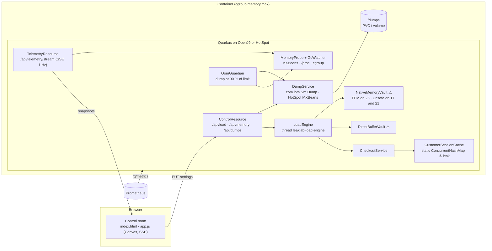

# LeakLab — JVM memory forensics on the Red Hat build of OpenJDK, IBM Semeru, Oracle Java and Eclipse Temurin (Java 17, 21 and 25), Quarkus and containers

A self-contained lab for the two memory failures every Java platform team eventually meets:

1. **A heap leak**: find it with heap dumps, from first symptom to a named line of code.
2. **The silent kill**: the JVM is configured to need more than its container allows, so the kernel SIGKILLs it before
   any `OutOfMemoryError`, GC or heap dump can happen.

It includes a Quarkus service that leaks on demand (in the heap, in direct buffers, or in raw native memory) and a
real-time control room for turning the load up and down. One container image runs as five memory configurations,
plus a manual one with your own sizing, on Docker Compose, Kubernetes or OpenShift, on the HotSpot or the OpenJ9 JVM,
and on Java 17, 21 or 25.

| | |
|---|---|
| Runtimes | Java 17, 21 or 25 LTS on the **Red Hat build of OpenJDK** (HotSpot; **21 is the default**), **IBM Semeru** (Eclipse OpenJ9), **Oracle OpenJDK** or **Eclipse Temurin** (both HotSpot): twelve variants |
| Framework | **Quarkus 3.40.1**: Quarkus REST + SSE, SmallRye Health, Micrometer/Prometheus, Scheduler |
| Images | build `maven:3.9.16-ibm-semeru-25-noble` (for every release) → run `registry.access.redhat.com/ubi9/openjdk-21` (the default), `ibm-semeru-runtimes:open-21-jre-noble` (or UBI 9 minimal), `container-registry.oracle.com/java/openjdk:21` or `eclipse-temurin:21-jdk`, and the same with `17` and `25` |
| Platforms | Docker / Podman Compose · Kubernetes (Kustomize) · OpenShift 4 (BuildConfig, ImageStream, Routes) |
| Frontend | Dependency-free HTML/Canvas served by Quarkus (works air-gapped) |

---

> **New to this area?** Start with the printable **[LeakLab Field Guide (PDF, A4)](https://github.com/Konstantinos-Mavridis/LeakLab/releases/latest/download/LeakLab-Field-Guide.pdf)**,
> attached to every [release](https://github.com/Konstantinos-Mavridis/LeakLab/releases).
> It walks through every step of every scenario twice: first in precise technical terms, then "like you're five".
> Its sources are in `docs/guide`; build it locally with `powershell -File docs/guide/build.ps1` (Windows, Chrome or
> Edge), which writes `docs/LeakLab-Field-Guide.pdf`. The PDF itself is not committed.

## Architecture



### What the control room shows

- **Configuration verdict**: `heap ceiling + native footprint + direct-memory allowance = projected peak` compared
  with the cgroup limit. The allowance is how far direct buffers may still grow before their own cap stops them.
  It classifies the setup as `SIZED`, `TIGHT`, `OOMKILL_LIKELY` or `OOMKILL_BY_DESIGN`.
- **Live signal**: the slope of the live set after GC (heap leak) compared with the slope of the non-heap footprint
  (off-heap leak), plus an estimate of when the container reaches its limit. It stays silent for the first 2 minutes of
  JVM uptime, because start-up warm-up (JIT, class loading) also grows the footprint.
- **Memory budget timeline**: heap, non-heap, direct, native and the rest of RSS, stacked against `-Xmx` and the
  cgroup limit. The area above the limit is hatched as the kill zone.
- **Load control**: leak target (Heap / Direct / Native), request rate, payload and retention. Every change applies
  live. The deck also shows the leak velocity in MiB/s and the time left before the limit.
- **Evidence capture**: one-click actions that write a heap dump (PHD on OpenJ9, HPROF on HotSpot), a javacore (a VM
  report with NMT on HotSpot) or a system core (OpenJ9 only: greyed out on HotSpot), plus the guardian's state and
  download links.
- **Kernel's view**: the cgroup `memory.events` counters (`max`, `oom`, `oom_kill`) and `memory.peak`.

---

## Quick start: Docker Compose

Pick the JVM and the Java version with an env file, `<jvm>-<version>.env`. Each variant runs as its own stack
(`leaklab-<jvm>-<version>`), with containers named `leaklab-<scenario>-<jvm>-<version>`, so all twelve can run side by side:

| Env file | JVM | Ports (A–D, M, G) | Dumps |
|---|---|---|---|
| `redhat-21.env` (**the default**) | Red Hat build of OpenJDK 21, on UBI 9: **HotSpot** | 6180–6183, 6184, 6185 | `./dumps/redhat-21/<scenario>` |
| `redhat-25.env` | Red Hat build of OpenJDK 25, on UBI 9: **HotSpot** | 6080–6083, 6084, 6085 | `./dumps/redhat-25/<scenario>` |
| `redhat-17.env` | Red Hat build of OpenJDK 17, on UBI 8 (image 1.21: 17.0.16, pinned): **HotSpot** | 6780–6783, 6784, 6785 | `./dumps/redhat-17/<scenario>` |
| `semeru-25.env` | IBM Semeru Runtime 25: the Eclipse **OpenJ9** VM | 8080–8083, 8084, 8085 | `./dumps/semeru-25/<scenario>` |
| `semeru-21.env` | IBM Semeru Runtime 21: **OpenJ9** | 8180–8183, 8184, 8185 | `./dumps/semeru-21/<scenario>` |
| `semeru-17.env` | IBM Semeru Runtime 17: **OpenJ9** | 8780–8783, 8784, 8785 | `./dumps/semeru-17/<scenario>` |
| `oracle-25.env` | Oracle's OpenJDK 25 build: **HotSpot** | 9080–9083, 9084, 9085 | `./dumps/oracle-25/<scenario>` |
| `oracle-21.env` | Oracle's OpenJDK 21 build: **HotSpot** (21.0.2, no longer updated) | 9180–9183, 9184, 9185 | `./dumps/oracle-21/<scenario>` |
| `oracle-17.env` | Oracle's OpenJDK 17 build: **HotSpot** (17.0.2, no longer updated) | 9780–9783, 9784, 9785 | `./dumps/oracle-17/<scenario>` |
| `temurin-25.env` | Eclipse Temurin 25 (Eclipse Adoptium): **HotSpot** | 7080–7083, 7084, 7085 | `./dumps/temurin-25/<scenario>` |
| `temurin-21.env` | Eclipse Temurin 21: **HotSpot** | 7180–7183, 7184, 7185 | `./dumps/temurin-21/<scenario>` |
| `temurin-17.env` | Eclipse Temurin 17: **HotSpot** | 7780–7783, 7784, 7785 | `./dumps/temurin-17/<scenario>` |

Which scenarios start is a compose profile. A plain `up` starts **M · manual**, your own sizing; `--profile all`
starts the fixed lab scenarios **A–D** and **G** instead; naming services starts exactly those.

```bash
docker compose --profile all up --build                           # A–D and G on the default, Red Hat 21
docker compose --env-file semeru-25.env --profile all up --build   # A–D and G on Semeru 25
docker compose --env-file temurin-21.env up --build sized          # one scenario on Temurin 21
docker compose --env-file temurin-21.env up --build                # M · manual on Temurin 21
docker compose --env-file semeru-25.env --profile all down         # stop and remove A–D and G (plain `down`: M;
                                                                   # --profile "*" down: everything)
```

The first port digit picks the JVM (6 Red Hat, 8 Semeru, 9 Oracle, 7 Temurin), the second the version (7 = Java 17,
1 = Java 21, 0 = Java 25). Without `--env-file`, compose reads `.env` and runs the default, Red Hat 21, whose ports the table uses.

| | URL | Scenario | Config | A leak ends in… |
|---|---|---|---|---|
| **A** | http://localhost:6180 | **sized**: the good failure | limit 1 GiB · `MaxRAMPercentage=60` · `MaxDirectMemorySize=96m` | `OutOfMemoryError`, with dumps written to `./dumps/redhat-21/sized`: an `.hprof` on HotSpot, javacore + PHD + snap on OpenJ9 |
| **B** | http://localhost:6181 | **overcommit**: explicit (`-Xmx` > limit) | limit 512 MiB · `-Xmx1g` · guardian off | **OOMKilled, exit 137, no dumps** |
| **C** | http://localhost:6182 | **greedy**: the percentage trap (implicit overcommit) | limit 1 GiB · `MaxRAMPercentage=95` · direct memory uncapped · starts on the **Direct** target | **OOMKilled** by a direct-buffer leak while the heap stays flat, with no `-Xmx` anywhere. The guardian captures evidence at 90 % |
| **D** | http://localhost:6183 | **native**: the leak no flag bounds | limit 768 MiB · `MaxRAMPercentage=50` · `MaxDirectMemorySize=64m` | OOMKilled although everything cappable is capped. The guardian captures a VM report (NMT) or javacore, and a heap dump, at 88 % first |
| **G** | http://localhost:6185 | **g1**: a common production setting | limit 1 GiB · `MaxRAMPercentage=80` · `-XX:+UseG1GC` · `G1ReservePercent=10` · direct memory uncapped | A heap leak ends in a Java `OutOfMemoryError` with dumps on all twelve variants. A direct-buffer leak is a coin toss: a Java OOM at the very edge of the limit on seven, an OOMKill on three, a JVM that hangs at 1013–1022 of 1024 MiB on two. The verdict is red from the start (the uncapped direct allowance) |
| **M** | http://localhost:6184 | **manual**: your own sizing (the plain `up`) | default: limit 1 GiB · `MaxRAMPercentage=75` · guardian on, all overridable | whatever your numbers say: the verdict banner tells you before any load |

### Your own sizing: the manual scenario

`manual` runs the same image with the limit, CPUs and JVM options you give it. **The JVM and the Java version come
from the env file, exactly as for A–D**: `--env-file temurin-21.env` runs it on Temurin 21 (port 7184), no env file
runs it on the default, Red Hat 21 (port 6184). **The sizing** comes from the variables below, all optional. Set them in the shell,
or in a second env file layered after the JVM's (the later file wins; the shell wins over both). The repository's
[`manual.env`](../manual.env) lists them all, commented out:

| Variable | Default | Sets |
|---|---|---|
| `LEAKLAB_MANUAL_MEM` | `1g` | the container limit (`mem_limit` and `memswap_limit`: no swap) |
| `LEAKLAB_MANUAL_CPUS` | `2` | CPUs; HotSpot picks Serial GC below 2 CPUs or 1792 MiB |
| `LEAKLAB_MANUAL_JAVA_OPTS` | `-XX:MaxRAMPercentage=75` | the JVM's sizing flags: `-Xmx…`, percentages, `-XX:MaxDirectMemorySize=…`, `-XX:+UseG1GC`, … |
| `LEAKLAB_MANUAL_LOAD_MODE` | `HEAP` | the leak target at start: `HEAP`, `DIRECT` or `NATIVE` |
| `LEAKLAB_MANUAL_GUARDIAN` | `true` | `false` to watch an OOMKill leave no evidence |
| `LEAKLAB_MANUAL_GUARDIAN_THRESHOLD` | `0.90` | when the guardian captures, as a fraction of the limit |
| `LEAKLAB_MANUAL_KEEP_RUNNING_ON_OOM` | `false` | `true`: the load engine keeps running after an OOM instead of pausing (also switchable in the UI) |

```bash
docker compose up --build                                               # defaults on Red Hat 21: http://localhost:6184
docker compose --env-file temurin-21.env --env-file manual.env up -d     # Temurin 21, sizing from manual.env: :7184
LEAKLAB_MANUAL_MEM=768m LEAKLAB_MANUAL_JAVA_OPTS="-Xmx600m -XX:MaxDirectMemorySize=64m" \
  docker compose --env-file oracle-21.env up -d                         # Oracle 21, sizing from the shell: :9184
docker compose --env-file temurin-21.env down                           # stop and remove it
```

In PowerShell, set the variables first: `$env:LEAKLAB_MANUAL_MEM="768m"`. For a sizing of your own, copy
`manual.env` to `<name>.local.env` (ignored by git). Running `up` again with new values recreates the container.
The verdict banner shows at once whether the numbers fit; then drive a leak from the UI. Evidence lands in
`./dumps/<jvm>-<version>/manual`, and `analyzer /dumps/<jvm>-<version>/manual` analyses it. The default is deliberately the most common production setting, and the verdict is red: 75 % leaves room for the heap
and the JVM, but not for uncapped direct memory. On Kubernetes, edit and apply
[`deploy/k8s/overlays/manual`](../deploy/k8s/overlays/manual/kustomization.yaml).

On Linux, make the bind-mounted dump folders writable for UID 1001 first: `mkdir -p dumps/{redhat,semeru,oracle,temurin}-{17,21,25}/{sized,overcommit,native,greedy,g1,manual} && chmod -R 777 dumps`.

### HotSpot versus OpenJ9, Java 17 and 21 versus Java 25

Red Hat, Oracle and Temurin run the same app, limits and `JAVA_OPTS` on the HotSpot VM, with HotSpot's own diagnostics
(`HeapDumpOnOutOfMemoryError`, NMT, unified GC log, `jcmd`); Semeru runs them on OpenJ9. Every scenario was verified on
all twelve variants, and the outcomes are not always the same: in `greedy`'s heap-leak variant, HotSpot 25 survives by
about 9 MiB where OpenJ9 is OOMKilled, and HotSpot 17 and 21, which need 20–40 MiB more outside the heap, are
OOMKilled too (the scenario's main experiment, the direct-buffer leak, is killed on all twelve). HotSpot also loses its
OOM dump after a restart unless the dump path is unique, and its guardian dump can get the container killed. Everything
else behaves the same on Java 17, 21 and 25, except that HotSpot 25 pauses far longer for a heap dump. The one code
difference: on Java 17 and 21, where FFM is not final, the native leak allocates with `sun.misc.Unsafe`, and the
evidence is the same. [Runbook 06](06-hotspot-jvms.md) has the side-by-side results
and ten gotchas.

Local run without containers (a JDK 21; or a JDK 17 or 25 with `-Dmaven.compiler.release=17` or `=25`):

```bash
cd app && mvn quarkus:dev          # http://localhost:8080 — the cgroup panels show "no cgroup"
```

## Quick start: OpenShift

```bash
oc new-project leaklab
oc apply -k deploy/openshift                       # ImageStream, BuildConfig, 5 Deployments + PVCs + Services + Routes
oc start-build leaklab --from-dir=app --follow     # in-cluster buildah build from your working copy
oc get route -o custom-columns=NAME:.metadata.name,HOST:.spec.host
```

Plain Kubernetes, for example Docker Desktop: `docker build -t leaklab:1.0.0 -f app/Containerfile app` builds the
default, Red Hat 21 (add the `--build-arg`s from the [Containerfile](../app/Containerfile) header for another JVM or
Java 25), then
`kubectl apply -k deploy/k8s/overlays/sized`, then `kubectl port-forward svc/leaklab-sized 8080`.

---

## Guided lab (about 45 minutes)

The exercises use the Semeru 25 stack (8080–8083), because they read OpenJ9's artefacts (javacores, PHDs): start it
with `docker compose --env-file semeru-25.env --profile all up --build`. On Semeru 21 only the ports change (see the
env-file table). On the default Red Hat 21, or on Oracle or Temurin, the steps are the same, but the artefacts are
HotSpot's: HPROF instead of PHD, a VM report (NMT) instead of a javacore, and `greedy`'s heap variant ends differently.
[Runbook 06](06-hotspot-jvms.md) has the differences.

### Exercise 1: healthy churn versus a leak (`sized`, :8080)
1. Apply the **Healthy churn** preset (200 req/s × 256 KiB, 0 % retained). Allocation is heavy and the GC is busy,
   but the green *live set after GC* line stays flat. This is what "not a leak" looks like.
2. Apply **Slow leak**. The floor starts to climb, the *Live signal* reports a heap leak signature, and the
   *Retained by the leak* tile counts `SessionContext` objects.
3. Take **heap dump D1**, wait 3 to 4 minutes, then take **D2**.
4. Follow [Runbook 01](01-heapdump-analysis-runbook.md): Leak Suspects, dominator tree, path to GC roots, then
   compare D1 with D2. The suspect is the static `CustomerSessionCache.SESSIONS`.
5. Apply **Aggressive leak** and let it run into `OutOfMemoryError`. The journal records it, OpenJ9's default dump
   agents write the OOM dump set to `./dumps/semeru-25/sized`, and the process stays alive and diagnosable.
   The load engine pauses at the OOM, which is what keeps it diagnosable: the leaked memory is still full, and more
   load would only raise more OOMs.
6. Optional: set **After an OutOfMemoryError** to **Keep running** (or `LEAKLAB_MANUAL_KEEP_RUNNING_ON_OOM=true` for
   the manual scenario) and repeat step 5. The engine now behaves like a real service that keeps receiving requests:
   OOMs every tick, a journal entry every 10 s with the count, and about a tenth of the load still served. What happens
   next depends on the JVM. Measured on `sized`: Red Hat 21 (HotSpot) kept answering for 4 minutes at about 50 % CPU,
   while Semeru 17 (OpenJ9) stopped answering after about 90 s. OOMs had killed its HTTP event loop and worker
   threads, leaving a zombie JVM at 100 % CPU that only a restart (`docker compose up -d --force-recreate sized`)
   clears. That is why production services should exit on the first OOM (`-XX:+ExitOnOutOfMemoryError`).

### Exercise 2: the silent kill (`overcommit`, :8081)
1. The verdict banner is already red: **-Xmx 1 GiB is larger than the 512 MiB limit**.
2. Apply **Aggressive leak**. The heap tile shows about 50 % used, while the working set climbs into the hatched kill zone.
3. The UI loses contact and its banner explains why. Then run:
   ```bash
   scripts/oomkill-forensics.sh docker leaklab-overcommit-semeru-25
   ```
   The output shows `OOMKilled=true` and exit code 137. There are no `JVMDUMP` lines, and `./dumps/semeru-25/overcommit` holds only verbose GC logs.
4. Read [Runbook 02](02-container-oomkill.md). Then set `LEAKLAB_GUARDIAN_ENABLED: "true"` and run it again.
   This time evidence exists.

### Exercise 3: "but we use MaxRAMPercentage" (`greedy`, :8082)
1. The verdict is red before any load. The heap fits (973 MiB of 1 GiB), but the verdict adds a direct-memory
   allowance of about the same size: without `MaxDirectMemorySize`, direct buffers may grow to ≈ the max heap, *on top
   of* the heap.
2. The leak target is already **Direct**. Apply **Aggressive leak**. The heap stays flat at ~60 MiB while direct buffers
   grow to 750–880 MiB by the time the guardian fires (its javacore: *Direct Byte Buffers*; on HotSpot the VM report's
   NMT *Other*). The UI's retained tile shows less, about 500 MiB: the rest are churned buffers whose Cleaners only run
   after a GC, and a flat heap rarely collects. The default direct cap is never reached: exit 137, on all twelve variants.
3. The fix is the bonus of Exercise 1's scenario: in `sized`, `MaxDirectMemorySize=96m` turns the same leak into a
   diagnosable `OutOfMemoryError: Cannot reserve … bytes of direct buffer memory`. It's thrown by `java.nio.Bits`, not
   the VM, so OpenJ9's default OOM dump agents ignore it; the image adds an `events=throw` agent so a heap dump and
   javacore are still written.
4. Variant, the knife edge: restart (`docker compose up -d --force-recreate greedy`) and choose the **Heap** target.
   OpenJ9 is OOMKilled with ~36 MiB of heap still free; HotSpot (Oracle, Temurin) survives by ~9 MiB with a Java OOM.
   Read [Runbook 02 §2b](02-container-oomkill.md#2b-overcommit-with-maxrampercentage-no--xmx-anywhere) for the
   measurements and every other way a percentage still overcommits.

### Exercise 4: the leak that the heap dump can't see (`native`, :8083)
1. Apply **Native bleed**. The heap and its live set stay flat while RSS and the working set climb. Heap and direct
   memory are both capped here: no JVM flag bounds native (FFM, Unsafe, JNI) memory.
2. Take a **javacore**, wait a minute, and take another. Diff the `NATIVEMEMINFO` sections.
3. The guardian fires at 88 % and writes a javacore and a PHD. The PHD is clean, which is the point.

### Exercise 5: the analysis stage (offline workbench)
Run the full toolchain (Eclipse MAT 1.17 headless + IBM DTFJ on a Semeru 25 JDK) against the evidence from Exercises 1 and 4:

```bash
docker compose --profile analysis run --rm analyzer /dumps/semeru-25/sized       # newest two heap dumps (no path: redhat-21/sized)
docker compose --profile analysis run --rm -e BASELINE=- analyzer /dumps/semeru-25/native
```

After Exercise 1, step 5, the two newest dumps are the OOM pair, written seconds apart. The analyzer warns that their
delta is noise. To compare D1 with D2, name them: `-e BASELINE=heapdump.sized.<D1>.phd -e TARGET=heapdump.sized.<D2>.phd`.

The analyzer runs ten steps (GC trend, leak suspects, histogram, histogram delta, dominator tree, immediate
dominators, OQL, path to GC roots, NATIVEMEMINFO or NMT delta) and writes `analysis/reports/<jvm>-<version>-<scenario>-<time>/SUMMARY.md`.
[Runbook 04](04-analysis-stage.md) walks through every step with real output. In the `native` run, notice how
MAT's Leak Suspects points at a harmless 24 MiB object, while the javacore delta finds the real leak: hundreds of
MiB under `sun.misc.Unsafe`.
Real example reports are in [`analysis/examples/`](../analysis/examples/).

---

## Repository map

```
app/
  Containerfile                         multi-stage build; runtime HotSpot (default: Red Hat 21) or OpenJ9 (--build-arg JVM=openj9), each with its
                                        JAVA_DIAG_OPTS; JAVA_VERSION=21|25 picks the release the jar is compiled for
  pom.xml                               Quarkus 3.40.1, Java 17, 21 (default) or 25: -Dmaven.compiler.release=25 activates the java25 profile
  src/main/java/io/leaklab/
    leak/      CustomerSessionCache     ← the heap leak (static, unbounded, unique keys)
               CheckoutService          ← the allocation site
               DirectBufferVault        ← direct-buffer leak
               NativeMemoryVault        ← native leak (invisible to heap dumps)
  src/main/native-ffm/                  NativeAllocator: FFM Arena, the Java 25 build
  src/main/native-unsafe/               NativeAllocator: sun.misc.Unsafe, the Java 17 and 21 builds (no final FFM there)
    load/      LoadEngine               ← real-time rate/payload/retention control
    telemetry/ MemoryProbe              ← heap/non-heap/pools/RSS/cgroup + the verdict
               CgroupReader             ← cgroup v2/v1: limit, working set, memory.events
               GcWatcher                ← GC notifications → live set after GC
               LeakMetrics              ← Prometheus gauges
    diag/      DumpService              ← OpenJ9: PHD / javacore / core (com.ibm.jvm.Dump) · HotSpot: HPROF / VM report (NMT)
               OomGuardian              ← pre-emptive dumps before the OOM killer
    api/       ControlResource, TelemetryResource (SSE)
  src/main/resources/META-INF/resources/  control room UI
analysis/
  Containerfile                         analyzer workbench: Semeru 25 JDK + Eclipse MAT 1.17 + IBM DTFJ
  bin/analyze.sh                        the 10-step analysis stage → reports/<jvm>-<version>-<scenario>-<time>/SUMMARY.md
  bin/mat.sh                            MAT batch wrapper: query | suspects | compare
  bin/gc-trend.sh                       OpenJ9 verbose GC or HotSpot unified GC log → live set after each full GC + verdict
  bin/nativemem-diff.sh                 javacore NATIVEMEMINFO or HotSpot NMT delta + verdict
  examples/{sized,native,greedy-heap,greedy-direct}/   real reports from the lab
compose.yaml                            A–D and G (profile "all"), manual (the plain up), analyzer (profile "analysis"); swap disabled, restart "no"
{redhat,semeru,oracle,temurin}-{17,21,25}.env  pick JVM and version: docker compose --env-file <jvm>-<version>.env up
                                        → stack leaklab-<jvm>-<version>, containers leaklab-<scenario>-<jvm>-<version>
.env · manual.env                       plain `up` = manual (no env file: Red Hat 21) · the manual sizing knobs, commented
deploy/k8s/base, overlays/{sized,overcommit,greedy,native,g1,manual}
deploy/openshift/                       BuildConfig, ImageStream, Routes, ServiceMonitor, kustomization (Red Hat 21 image)
scripts/oomkill-forensics.sh            Java OOM vs. OOMKill verdict (docker | k8s)
scripts/collect-evidence.sh             OpenJ9: SIGQUIT → javacore + PHD · HotSpot: jcmd → HPROF.gz + VM report; copy out
docs/01-heapdump-analysis-runbook.md    step-by-step suspect identification
docs/02-container-oomkill.md            the "killed before OOM" question, in depth
docs/03-tooling-matrix.md               tools, flags, javacore sections, MAT checklist
docs/04-analysis-stage.md               the analysis stage, every tool run for real
docs/05-forensics-readiness.md          what must exist BEFORE an incident (flags, image, platform; restart or not)
docs/06-hotspot-jvms.md                 every scenario on Red Hat, Oracle and Temurin (HotSpot) vs Semeru (OpenJ9), and Java 17 vs 21 vs 25: results, HotSpot gotchas
docs/guide/                             the A4 field guide's sources: src/*.html (one per chapter), guide.css, build.ps1
                                        (headless Chrome/Edge print-to-PDF, two passes for two-sided printing); the
                                        PDF is published as a release asset, not committed
```

## API

| Method | Path | Body / result |
|---|---|---|
| GET | `/api/telemetry` · `/api/telemetry/stream` (SSE) | full snapshot |
| GET/PUT | `/api/load` | `{running, mode: HEAP\|DIRECT\|NATIVE, ratePerSecond, payloadKb, retentionPercent, keepRunningOnOom}`; `keepRunningOnOom` is optional, and leaving it out keeps the current value |
| POST | `/api/load/burst` | `{mode, megabytes}` |
| POST | `/api/memory/release` · `/api/memory/gc` | |
| GET | `/api/dumps` · `/api/dumps/{name}/download` | |
| POST | `/api/dumps/{heap\|javacore\|system}` | |
| GET | `/q/metrics` · `/q/health/{live,ready,started}` | |

> **Lab only.** The control and dump-download endpoints are unauthenticated. Dumps contain process memory. Never
> expose this on a production route.
